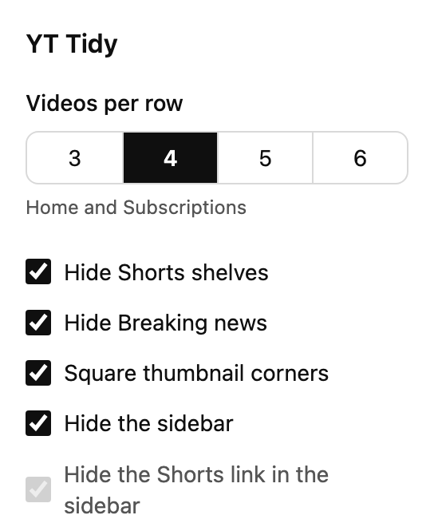

# YT Tidy

A Chrome extension that cleans up the YouTube home page:

1. Hides the Shorts shelves on Home and Subscriptions.
2. Hides the Breaking news shelf on Home.
3. Hides the left sidebar, so the video grid gets the full width.
4. Shows 4 videos per row on Home and Subscriptions, instead of YouTube's 3.
5. Squares off the rounded corners on thumbnails and their hover highlight.

Each one can be switched off, and the row count changed (3 to 6), from the toolbar popup.

## Install

1. Download this repository (`git clone` or **Code → Download ZIP**, then unzip).
2. Open `chrome://extensions` and turn on **Developer mode** (top right).
3. Click **Load unpacked** and pick the folder that holds `manifest.json`.
4. Reload any open YouTube tabs.

It needs only the `storage` permission (for your settings) and runs only on `www.youtube.com`. It sends nothing anywhere.

## How it works

- `src/content.css` does the hiding and sets YouTube's own `--ytd-rich-grid-items-per-row` variable. YouTube writes that variable inline from its width maths; an `!important` stylesheet value overrides it.
- YouTube drops a shelf (Breaking news, "Most relevant", Shorts) into the feed after every few rows of its 3-wide grid. At 4 wide those land mid-row and leave gaps, so `src/content.js` sets the CSS `order` of each shelf to hold it back until the row it interrupted is full. Section headings such as "Latest" on Subscriptions are left in place.
- Settings live in `chrome.storage.sync` and are applied as `data-ytt-*` attributes on `<html>`. Every rule is on by default in CSS, so nothing flashes on page load.

## Notes

- With the sidebar hidden, the menu button goes too. Subscriptions is still at `youtube.com/feed/subscriptions`, or switch the sidebar back on in the popup.
- The Breaking news shelf and the sidebar's Shorts link have no marker of their own, so they are matched by their English titles ("Breaking news", "Shorts"). In other languages they will not be found.
- YouTube changes its markup often. If something stops working, open an issue with the page and what you see.

## License

MIT
