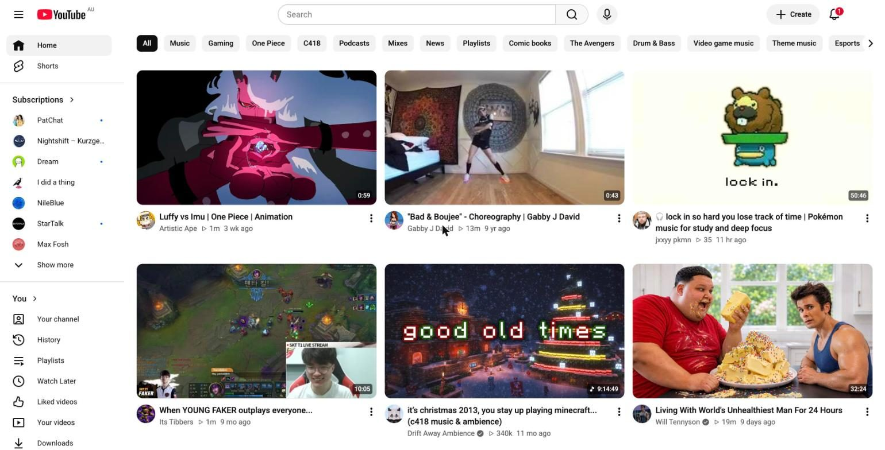
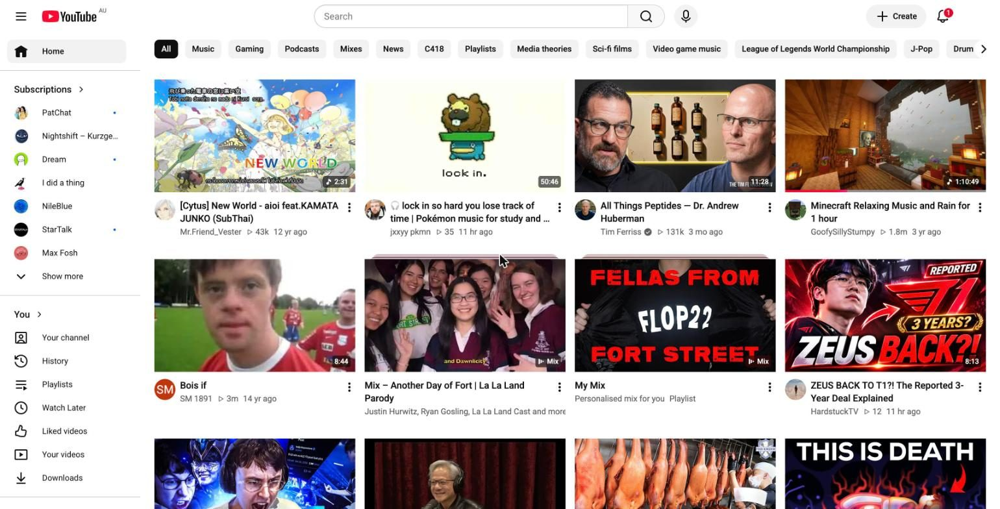

# YT Tidy

A Chrome extension that cleans up the YouTube home page:

1. Hides the Shorts shelves on Home and Subscriptions.
2. Hides every other shelf too: Breaking news, Mixes, Recently played, games, "Most relevant" on Subscriptions, and any new kind YouTube adds.
3. Shows 5 videos per row instead of YouTube's 3, or any count from 3 to 8. With Auto-fit on, that count is for a normal screen (1440 to 1920px wide), and it scales with the window: 6 becomes 8 at 2560px and 11 on a 3440px ultrawide.
4. Squares off the rounded corners on thumbnails and their hover highlight.
5. Optionally hides the left sidebar too, so the grid gets the full width (off by default).

Each one can be switched on or off from the toolbar popup.

### Before

### After

### Settings

## Install

1. Download this repository (`git clone` or **Code → Download ZIP**, then unzip).
2. Open `chrome://extensions` and turn on **Developer mode** (top right).
3. Click **Load unpacked** and pick the folder that holds `manifest.json`.
4. Reload any open YouTube tabs.

It needs only the `storage` permission (for your settings) and runs only on `www.youtube.com`. It sends nothing anywhere.

## How it works

- `src/content.css` does the hiding and sets YouTube's own `--ytd-rich-grid-items-per-row` variable. YouTube writes that variable inline from its width maths; an `!important` stylesheet value overrides it.
- Shelves are matched by their format (a titled row of cards with a "Show more" button), not by their titles, so new kinds are hidden too. Any shelf you keep gets cards the same size as the grid's.
- With Auto-fit on, `src/content.js` scales the chosen count by the window's width past 1920px (or under 1440px) and updates it as you resize.
- YouTube drops a shelf into the feed after every few rows of its 3-wide grid. At other widths those land mid-row and leave gaps, so `src/content.js` sets the CSS `order` of each shelf to hold it back until the row it interrupted is full. Section headings such as "Latest" on Subscriptions are left in place.
- Settings live in `chrome.storage.sync` and are applied as `data-ytt-*` attributes on `<html>`. The hiding rules are on by default in CSS, so no shelf flashes on page load. Hiding the sidebar is opt-in and waits for your settings to load.

## Notes

- With the sidebar hidden, the menu button goes too. Subscriptions is still at `youtube.com/feed/subscriptions`, or switch the sidebar back on in the popup.
- The sidebar's Shorts link has no marker of its own, so it is matched by its English title ("Shorts"). In other languages it will not be found.
- YouTube changes its markup often. If something stops working, open an issue with the page and what you see.

## License

MIT
